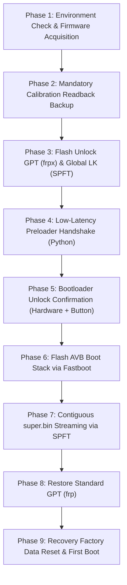

# Xiaomi Smart Clock LX04 China-to-Global (X04G) Conversion Guide

[](LICENSE)
[](docs/HARDWARE_SPECIFICATIONS.md)
[-green.svg)](docs/FIRMWARE_ARCHITECTURE.md)
[-blue.svg)](docs/PROJECT_POSTMORTEM.md)

A complete, verified single-device engineering guide and open-source tooling suite to permanently convert the **Xiaomi XiaoAI Smart Clock (China Model: `LX04`)** to the **Official Global Firmware (Model: `X04G`)** running **Android 10**.

> [!IMPORTANT]
> **Single-Device Validation & Independent Reproducibility:** This procedure was engineered and physically verified on a single development unit (Xiaomi LX04 equipped with Kingston 4GB eMMC). Any technically competent user with a Windows PC can follow this manual procedure independently. Note that script syntax validation on a PC does NOT prove physical compatibility on different hardware revisions (such as non-Kingston eMMC chips).

---

## 1. What This Project Does

The Xiaomi Smart Clock sold in mainland China (model `LX04`, board `mico_lx04`) is locked to mainland Chinese IoT servers, supports only Mandarin Chinese XiaoAI voice interaction, and cannot interface with Google Assistant or western time/weather services. 

Through hardware reverse engineering of MediaTek's Little Kernel (LK) and Download Agent (DA), safe GPT partition synthesis, and Preloader serial handshake interception, this project migrates the device to the official international firmware (`mico_x04g` build `QP1A.190711.020 / 1.7.5 user/release-keys`) while **preserving factory RF calibration, unique Wi-Fi MAC address, and hardware serial numbers**.

### Confirmed Working Subsystems (Direct Physical Verification on Single Kingston Unit)
The following features have been personally tested and confirmed operational by the device owner on the physical development unit (Kingston 4GB eMMC):
- [x] **Global Android 10 Operating System:** Boots cleanly past bootloader into responsive UI.
- [x] **LCD Display Panel:** Full 800 × 480 WVGA resolution, correct orientation, active backlighting.
- [x] **Capacitive Touchscreen:** Smooth gesture and multi-touch response across entire digitizer.
- [x] **Wi-Fi Connectivity (2.4 GHz):** Scans networks, authenticates, maintains persistent connection.
- [x] **Bluetooth 5.0 LE:** Bluetooth stack active; advertising, discovery, and pairing functional.
- [x] **Audio / Speaker:** Clean system chime and high-fidelity sound reproduction.
- [x] **Far-Field Microphone Array (Verified by Owner):** Dual-microphone hardware capture operational with Everest ADC; clean voice command acquisition.
- [x] **Google Assistant Voice Commands (Verified by Owner):** Voice recognition and spoken feedback confirmed across multiple test cases:
  - Asked for current weather: recognized accurately with spoken audio forecast response.
  - Asked for current time: recognized accurately with spoken time report.
  - Asked to set alarm: voice command processed and alarm successfully configured.
- [x] **Xiaomi App Detection (Verified by Owner):** Converted clock is detected and recognized in the official Xiaomi companion app.

### Untested Features & Operational Scope
- **OTA System Updates:** **[UNTESTED]**. Official over-the-air updates have not been evaluated. While unlocked bootloaders and custom partition layouts typically cause stock OTA updates to fail or risk re-locking the bootloader, OTA behavior has not been tested. Disabling automatic updates in Developer Options is recommended.
- **Extended Google Assistant Features:** While core voice queries (weather, time, alarms) and Xiaomi app detection are confirmed, every possible third-party integration or streaming feature has not been exhaustively tested.
- **Boot Warning:** Because the bootloader is unlocked, a cosmetic 5-second `Orange State` or `Red State` warning is displayed during power-on.
- **Single-Device Validation:** All tests were conducted on a single Kingston 4GB eMMC development clock and have not yet been independently reproduced on units with alternate flash hardware.

---

## 2. Hardware Compatibility Warning

> [!CAUTION]
> This guide is strictly engineered and validated for:
> - **Device:** Xiaomi Smart Clock (China Model: `LX04`).
> - **Motherboard:** `mico_lx04`.
> - **SoC:** MediaTek MT8167A (Quad Cortex-A35).
> - **Storage:** Kingston 4GB eMMC 5.1 (`M62704`, exactly `7,405,568` sectors).
>
> **DO NOT ATTEMPT on other Xiaomi smart display devices (such as the Pro 8, Smart Display 10, or devices with non-Kingston eMMC storage) without independently verifying partition geometry.**

---

## 3. Critical Safety Rules (Avoid Bricking)

1. **NEVER execute `Format All + Download` or `Firmware Upgrade` in SP Flash Tool.** Doing so wipes eMMC byte offsets `0x00380000` (`nvram`) and `0x00080000` (`proinfo`), permanently destroying your factory Wi-Fi MAC address and radio calibration.
2. **NEVER flash `super.bin` via Fastboot.** Little Kernel on MT8167 has a critical multi-chunk bug that resets the write pointer to `0x00000000` on each chunk, corrupting the dynamic filesystem. `super.bin` must be flashed contiguously via SP Flash Tool.
3. **NEVER overwrite eMMC `BOOT1` without an offline backup.** SP Flash Tool operations with `preloader` enabled will overwrite `BOOT1` with the Global preloader. Always dump your original Chinese `BOOT1` first.

---

## 4. Prerequisites & Requirements

### Required PC Hardware & Operating System
- Windows 10 (64-bit) or Windows 11 (64-bit).
- Standard USB-A to Micro-USB 2.0 data cable (connect directly to motherboard USB port).
- 5 GB free disk space.
- Time required: **~25 to 45 minutes** for initial conversion.

### Required Software & Tooling
For complete installation instructions, download sources, and configuration details for every tool used in this project, refer to the [**Tools Guide**](tools/README.md) and the [**Tool Versions Matrix**](tools/TOOL_VERSIONS.md).

1. **Python 3.8+** (with python added to Windows `PATH`). All repository scripts use standard library modules only; no `pyserial` or `pip` packages required. See [`tools/utilities/README.md`](tools/utilities/README.md).
2. **Android SDK Platform Tools** (`fastboot.exe` added to Windows `PATH`). See [`tools/adb-fastboot/README.md`](tools/adb-fastboot/README.md) and [`prerequisites/WINDOWS_SETUP.md`](prerequisites/WINDOWS_SETUP.md).
3. **MediaTek USB VCOM Drivers** (`3.0.1511.0` or compatible). See [`tools/usb-drivers/README.md`](tools/usb-drivers/README.md) and [`prerequisites/DRIVER_SETUP.md`](prerequisites/DRIVER_SETUP.md).
4. **SP Flash Tool v5.1728.00 / v5.1812.00** (Win32). See [`tools/sp-flash-tool/README.md`](tools/sp-flash-tool/README.md).
5. **MTK Client** (Optional diagnostic tool). See [`tools/mtk-client/README.md`](tools/mtk-client/README.md).

### Separately Obtained Proprietary Files (Legal Notice)
To comply with copyright laws, proprietary firmware binaries and signed Download Agents are NOT distributed in this repository. Users must obtain:
1. **Verified Global Firmware Archive:** `dump_mico_x04g.tar.xz` (extracted into `firmware/`). Detailed per-partition specifications, checksum manifests, and extraction instructions are provided in [`firmware/README.md`](firmware/README.md), [`firmware/global-x04g/README.md`](firmware/global-x04g/README.md), and [`firmware/firmware_manifest.json`](firmware/firmware_manifest.json).
2. **Authentic Signed Download Agent & Auth File:** `DA_Mi_Hikaru-resign.bin` and `auth_sv5.auth` (placed into `tools/`). See [`tools/sp-flash-tool/README.md`](tools/sp-flash-tool/README.md).

---

## 5. Overview of the Flashing Lifecycle



---

## 6. Step-by-Step Conversion Procedure

### Step 1: Environment & Firmware Check
1. Open Windows PowerShell as Administrator and run the environment check:
   ```powershell
   python scripts/setup/check_environment.py
   ```
2. Extract the verified Global firmware archive (`dump_mico_x04g.tar.xz`) into `firmware/` as detailed in [`firmware/README.md`](firmware/README.md).
3. Verify file integrity against the cryptographic manifest:
   ```powershell
   python scripts/verification/verify_checksums.py
   ```
   *Do not proceed until all files return `[MATCH]`.*

---

### Step 2: Mandatory Calibration Readback Backup
Protect your clock's factory calibration before writing anything.

> [!WARNING]
> **CRITICAL ADDRESS NOTICE:** SP Flash Tool v5.1812 Readback tab operates in **HEXADECIMAL BYTE OFFSETS**, not LBA sector numbers. Early documentation drafts containing `0xC000` / `0x28000` were transcription bugs that dumped unpartitioned space; any backup taken with those old offsets is **UNVERIFIED / INVALID**. Use the verified byte addresses below:

1. Open **SP Flash Tool v5.1812**.
2. Select Download-Agent: `tools/DA_Mi_Hikaru-resign.bin`.
3. Select Scatter-loading file: `configurations/scatter/convert_scatter_global.txt`.
4. Go to **Readback** tab and configure entries on `EMMC_USER`:
   - `proinfo`: Start `0x00080000`, Length `0x00300000` (3 MB) -> `backup/proinfo.bin`
   - `nvram`: Start `0x00380000`, Length `0x00500000` (5 MB) -> `backup/nvram.bin`
   - `protect1`: Start `0x00880000`, Length `0x00A00000` (10 MB) -> `backup/protect1.bin`
   - `protect2`: Start `0x01280000`, Length `0x00A00000` (10 MB) -> `backup/protect2.bin`
5. Configure entry on `EMMC_BOOT_1`:
   - `boot1`: Start `0x00000000`, Length `0x00200000` (2 MB) -> `backup/boot1.bin`
6. Click **Read Back**, plug in the clock via USB, and wait for the green OK circle. Unplug USB.
7. Verify `backup/proinfo.bin` in a hex editor: the first 32 bytes must show your device barcode/serial text string. *(Note: `nvdata` is NOT backed up here because stock Chinese firmware did not possess an `nvdata` partition; it used `protect1` and `protect2`. Under Global Android 10, the newly defined `nvdata` partition at `0x0B340000` is formatted as ext4 and populated from preserved `nvram` on first boot, an **[INFERRED]** mechanism based on standard MediaTek Android 10 architecture).*

---

### Step 3: Flash Unlock GPT (`frpx`) & Global Little Kernel
To bypass the factory FRP lock check, we flash the synthesized GPT where partition 12 is de-masked to `frpx`:

> [!NOTE]
> **Preloader BOOT1 Behavior:** SP Flash Tool uses `preloader_mico_x04g.bin` to parse EMI DRAM timing tables. Setting `enable="true"` causes SPFT to write the Global preloader to eMMC `BOOT1`. This is expected and required to boot Global Little Kernel.

1. In SP Flash Tool **Download** tab:
   - Mode: **Download Only**.
   - Check `pgpt`: Point to `configurations/gpt/gpt_x04g_unlock.bin`.
   - Check `sgpt`: Point to `configurations/gpt/gpt_backup_x04g_unlock.bin`.
   - Check `lk`: Point to `firmware/lk.bin`.
   - Check `lk2`: Point to `firmware/lk.bin`.
   - Ensure all other partitions are **UNCHECKED**.
2. Click **Download**, connect USB, and wait for the green OK circle. Unplug USB.

---

### Step 4: Intercept Boot to Enter Fastboot Mode
1. In PowerShell, run the native Win32 low-latency interceptor script:
   ```powershell
   python scripts/fastboot/preloader_fastboot_interceptor.py --port COM5
   ```
   *(Or pass `--auto-detect` to automatically detect the port when USB is plugged in).*
2. Plug the USB cable into the clock.
3. The script catches the Preloader handshake and forces Little Kernel into Fastboot:
   `>>> [SUCCESS] ACK RECEIVED: TOOBTSAF! Device is in FASTBOOT MODE! <<<`
4. The script automatically verifies that `fastboot devices` enumerates.

---

### Step 5: Execute Permanent Bootloader Unlock
1. In PowerShell, run:
   ```powershell
   fastboot flashing unlock
   ```
2. The clock LCD will prompt:
   *"Unlock bootloader? Press Volume Up (+) to confirm, Volume Down (-) to cancel."*
3. **Press the physical Volume Up (+) button on top of the clock.**
4. Terminal will report:
   ```text
   OKAY [ 12.450s ]
   Finished. Total time: 12.450s
   ```
5. Verify unlock status:
   ```powershell
   fastboot getvar unlocked
   ```
   *Expected Output: `unlocked: yes`.*

---

### Step 6: Flash Global Boot Stack via Fastboot
Flash the official Android 10 kernel, device tree, recovery, and AVB 2.0 signatures:
```powershell
python scripts/fastboot/flash_global_bootstack.py
```
*(Or execute `configurations/fastboot/fastboot_flash_all.bat` in Command Prompt).*
The script validates all 10 images before flashing, verifies unlock status, flashes each partition, and erases `userdata`.

---

### Step 7: Stream `super.bin` Contiguously via SP Flash Tool

> [!WARNING]
> Do NOT flash `super.bin` using Fastboot. Little Kernel's multi-chunk write bug corrupts sparse images. You must use SP Flash Tool.

1. Unplug the clock from USB.
2. In SP Flash Tool, load XML configuration `configurations/spft/download_super_contiguous.xml`.
3. Verify that `super` (1.50 GB) is checked and mapped to `firmware/super.bin`.
4. Click **Download**.
5. Plug the USB cable into the clock.
6. The progress bar will stream `super.bin` contiguously directly into flash at ~19.77 MB/s for ~81 seconds.
7. Wait for the green OK circle. Unplug USB.

---

### Step 8: Restore Standard GPT Layout
1. In SP Flash Tool, load `configurations/spft/download_gpt_restore.xml` (or check `pgpt` and `sgpt` pointing to `configurations/gpt/gpt_x04g_kingston.bin` and `configurations/gpt/gpt_backup_x04g_kingston.bin`).
2. Click **Download** and connect USB.
3. This restores the partition name from `frpx` back to `frp`, restoring standard Android FRP security.

---

### Step 9: Recovery Factory Data Reset & First Boot
1. Power on the clock into Recovery mode (or run `fastboot reboot-recovery`).
2. The screen will display:
   ```text
   xiaomi/mico_x04g/mico_x04g
   10/QP1A.190711.020/1.7.5
   user /release-keys
   can't load android system your data may be corrupt
   ```
3. Use the physical volume buttons to highlight **Factory data reset**.
4. Press the **Power / Mute** button to select.
5. Confirm by selecting **Yes**.
6. Recovery will format `/data` and generate fresh Android 10 cryptographic keys.
7. Select **Reboot system now**.
8. **GLOBAL ANDROID 10 BOOTS:** The device will boot past the 5-second Orange State warning into the official Global Setup Wizard.

---

## 7. Repository Layout

```text
xiaomi-lx04-global-conversion/
├── README.md                      # Primary project overview & installation manual
├── LICENSE                        # MIT Open-Source License
├── DISCLAIMER.md                  # Hardware risk & warranty voidance notice
├── CHANGELOG.md                   # Version release notes & milestone tracking
├── CONTRIBUTING.md                # Community guidelines for contributions
├── SECURITY.md                    # Hardware safety policy & vulnerability reporting
│
├── docs/                          # Comprehensive technical reference documentation
│   ├── PROJECT_POSTMORTEM.md      # Detailed engineering postmortem & breakthroughs
│   ├── CONVERSION_TIMELINE.md     # Minute-by-minute evidentiary chronological log
│   ├── TRIALS_AND_ERRORS.md       # In-depth technical autopsy of all 8 flash failures
│   ├── FINAL_CONVERSION_GUIDE.md  # Pure manual step-by-step conversion reference
│   ├── PROJECT_STATISTICS.md      # Duration, partition audits & hardware metrics
│   ├── HARDWARE_SPECIFICATIONS.md # IC components, memory boundaries & pinouts
│   ├── FIRMWARE_ARCHITECTURE.md   # Boot chain, AVB 2.0 & Dynamic Partitions
│   ├── PARTITION_MAP.md           # Reconstructed Kingston 4GB eMMC LBA sector map
│   ├── TROUBLESHOOTING.md         # Diagnostic lookup & error code resolutions
│   ├── RECOVERY_GUIDE.md          # Emergency unbrick & Chinese rollback guide
│   ├── FAQ.md                     # Frequently asked community questions
│   └── GLOSSARY.md                # MediaTek & Android technical terminology
│
├── prerequisites/                 # Host preparation & driver configuration
│   ├── WINDOWS_SETUP.md           # Windows OS, Python & Platform Tools setup
│   ├── DRIVER_SETUP.md            # BROM, Preloader VCOM & Fastboot driver setup
│   └── TOOL_VERSIONS.md           # Tool hashes & verified hardware revisions
│
├── scripts/                       # Validated automation tooling
│   ├── setup/
│   │   └── check_environment.py   # Host environment & dependency validator
│   ├── backup/
│   │   └── make_readback_scatter.py # Calibration backup guide generator
│   ├── verification/
│   │   ├── verify_checksums.py    # Cryptographic SHA-256 hash verifier
│   │   └── verify_device_state.py # Fastboot hardware state inspector
│   ├── fastboot/
│   │   ├── preloader_fastboot_interceptor.py # Win32 low-latency Preloader hook
│   │   └── flash_global_bootstack.py         # Automated Fastboot AVB flasher
│   └── utilities/
│       └── patch_gpt_unlock.py    # GPT FRP de-masking & CRC32 recalculator
│
├── configurations/                # Flashing profiles, GPTs & manifests
│   ├── scatter/
│   │   └── convert_scatter_global.txt # Global MT8167 scatter configuration
│   ├── spft/
│   │   ├── download_gpt_unlock.xml    # SPFT profile for unlock GPT
│   │   ├── download_gpt_restore.xml   # SPFT profile for standard GPT
│   │   └── download_super_contiguous.xml # SPFT profile for super partition
│   ├── gpt/
│   │   ├── gpt_x04g_kingston.bin          # Synthesized Primary GPT (frp)
│   │   ├── gpt_backup_x04g_kingston.bin   # Synthesized Secondary GPT (frp)
│   │   ├── gpt_x04g_unlock.bin            # Synthesized Primary GPT (frpx)
│   │   └── gpt_backup_x04g_unlock.bin     # Synthesized Secondary GPT (frpx)
│   └── fastboot/
│       ├── fastboot_flash_all.bat         # Batch flasher for Windows Command Prompt
│       └── fastboot_flash_all.ps1         # PowerShell flasher for core bootchain
│
├── tools/                         # Actual conversion applications & tooling suite
│   ├── README.md                  # Central tooling index & legal redistribution policy
│   ├── TOOL_VERSIONS.md           # Tool versions, binary names & hardware compatibility
│   ├── sp-flash-tool/             # SP Flash Tool v5.1812 documentation & configuration
│   │   └── README.md
│   ├── mtk-client/                # Bjoern Kerler mtkclient setup & readback commands
│   │   └── README.md
│   ├── adb-fastboot/              # Android Platform Tools setup & multi-chunk warning
│   │   └── README.md
│   ├── usb-drivers/               # MediaTek VCOM & Fastboot USB drivers guide
│   │   └── README.md
│   └── utilities/                 # Python, tar.exe, 7-Zip & archive utilities guide
│       └── README.md
│
├── firmware/                      # Global firmware documentation & integrity manifests
│   ├── README.md                  # Firmware acquisition instructions & hash table
│   ├── firmware_manifest.json     # Machine-readable firmware partition specification
│   └── global-x04g/               # Global build 1.7.5 component guide & checksums
│       ├── README.md
│       └── SHA256SUMS.txt
│
├── checksums/
│   └── SHA256SUMS.txt             # Verified cryptographic checksums manifest
│
├── examples/
│   ├── expected_outputs/
│   │   ├── fastboot_getvar_all.txt        # Verified Fastboot query output
│   │   └── preloader_handshake_trace.txt  # Serial handshake trace
│   └── sample_logs/
│       └── recovery_boot_log.txt          # Recovery screen wipe transcript
│
└── .github/                       # GitHub community templates & automation
    ├── ISSUE_TEMPLATE/
    │   ├── bug_report.md          # Structured bug report template
    │   └── device_inquiry.md      # Hardware inquiry template
    └── workflows/
        └── ci_validate_scripts.yml # GitHub Actions script & XML syntax validator
```

---

## 8. Troubleshooting & Emergency Recovery

If you encounter errors during the procedure:
- Consult the [**`TROUBLESHOOTING.md`**](docs/TROUBLESHOOTING.md) guide for solutions to common USB, driver, and Fastboot errors.
- If your device displays a black screen or loops at the logo, follow the [**`RECOVERY_GUIDE.md`**](docs/RECOVERY_GUIDE.md) to unbrick or restore your original Chinese backup.

---

## 9. Credits & Acknowledgements

- **Engineering & Reverse Engineering:** MediaTek Little Kernel disassembly, Preloader interception, and GPT partition synthesis.
- **MediaTek Inc. & Xiaomi Inc.:** Original hardware and software design.
- **AyraHikari & Octathorp:** Early community documentation of Xiaomi MT8167 smart clocks on GitHub and XDA Developers.
- **B. Kerler (`mtkclient`):** Open-source research into MediaTek BROM protocols and exploit primitives.
