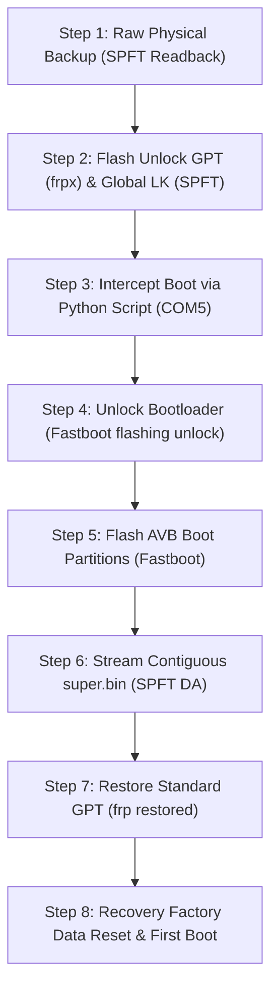

# FINAL CONVERSION GUIDE: Xiaomi Smart Clock LX04 China-to-Global (X04G)

**Document Version:** 1.1.0  
**Target Device:** Xiaomi XiaoAI Smart Clock (Model: `LX04`, Board: `mico_lx04`, Kingston eMMC `M62704`)  
**Target Firmware:** Official Xiaomi Global Smart Clock (Model: `X04G`, Build: `QP1A.190711.020 / 1.7.5 user/release-keys`)  
**Validation:** Verified on Single Physical Development Unit  

> [!CAUTION]
> **CRITICAL HARDWARE WARNINGS:**
> 1. **NEVER execute `Format All + Download` or `Firmware Upgrade` in SP Flash Tool.** Doing so erases the factory OTP calibration tables (`nvram`, `proinfo`), permanently destroying device Wi-Fi MAC addresses and RF calibration.
> 2. **NEVER overwrite eMMC `BOOT1` without an offline backup.** SP Flash Tool operations with `preloader` enabled write `preloader_mico_x04g.bin` to `BOOT1`. Always preserve your original Chinese `BOOT1` backup before proceeding.
> 3. **Follow the dual-tool sequence exactly:** SP Flash Tool is required for GPT partitions and contiguous `super` streaming; Fastboot is required for AVB boot partitions.

---

## 1. Prerequisites & Required Tools

### 1.1 Host Environment
- **Operating System:** Windows 10 / 11 (64-bit).
- **USB Interface:** Standard USB 2.0 Micro-USB data cable (connected directly to motherboard root hub).
- **Driver Stack:** MediaTek Preloader USB VCOM Port driver (automatically binds to COM port, e.g. `COM5`).
- **Python Environment:** Python 3.8+ (standard library only; no external pip packages required).

### 1.2 Flashing & Diagnostic Software
1. **SP Flash Tool:** v5.1812.00 (Win32).
2. **Android Platform Tools:** Fastboot CLI (v1.1916.00 or latest Android SDK Platform Tools in `PATH`).
3. **Preloader Interception Script:** `scripts/fastboot/preloader_fastboot_interceptor.py`.

---

## 2. Firmware Artifacts & Integrity Hashes

Verify all files against these SHA-256 hashes before flashing:

| File Name | Exact Size (Bytes) | SHA-256 Hash | Purpose |
| :--- | :--- | :--- | :--- |
| `DA_Mi_Hikaru-resign.bin` | 1,048,576 | *OEM Signed* | Authentic OEM Download Agent Stage 1 & 2 |
| `boot1_physical_backup.bin` | 2,097,152 | `9280f36941daf7ac2b096511252346be4e24e634568b1f92de907e9477f11319` | Physical eMMC BOOT1 Readback (Contains Global Preloader at offset `0x800`) |
| `preloader_mico_x04g.bin` | 169,132 | `84f621317857a28f5566919c3e0770004ecba4f1583a12477b129a2fee3aa530` | Official Global Preloader (Flashed at offset `0x800` of `BOOT1`) |
| `lk.bin` | 524,288 | `79150412079402b321f1e7f2128da273d159dbc569557261bfc8ce663f1427fd` | Global Little Kernel (LK v2.0) |
| `boot.bin` | 16,777,216 | `ca7719a8a9407b4d47dfeb5a15b6ab810b43f4de41ff43c0bf265b2ecfcd3d4d` | Global Android 10 Kernel & Ramdisk |
| `dtbo.bin` | 1,048,576 | `487141aa53a275f0bae74199c6ac70e49a0a78a8c15fbeb4af5a26a2de0b25a3` | Global Device Tree Blob Overlay |
| `vbmeta.bin` | 4,194,304 | `1bb93a61c5da5473afe296e4270a9b20c13fbba16539f812a38e72f5fdb8517c` | Global AVB 2.0 Root Signature |
| `vbmeta_system.bin` | 4,194,304 | `affa5a3c0cdd084d1c9a9e2ef6c647d2434eef4e3a025b780f03eef28af3cebb` | Global AVB System Chain Descriptor |
| `vbmeta_vendor.bin` | 4,194,304 | `532d22f3f651378abf1c20a21c412580fdd6872813e852f8f4a1b9da64709b49` | Global AVB Vendor Chain Descriptor |
| `super.bin` | 1,610,612,736 | `271127b4d3a901b0a3c8ad6f08de6c915a39a0da7ad4f5d4ddf05548f8f3aca7` | Android 10 Dynamic Partitions Container |
| `recovery.bin` | 16,777,216 | `ac475a12ddfd6c4ebab0bd91fa4401dee8e188de1a77bcae1d7d04be99aa5a2c` | Global Android Recovery |
| `gpt_x04g_unlock.bin` | 17,408 | `2b73e696b2282c8b52613d5cd9d4907cf6bd3eed6046abc50f4e61eee3a0621e` | Unlock Primary GPT (`frpx` de-masked) |
| `gpt_x04g_kingston.bin`| 17,408 | `f9c80034c206d61eee60cba3f290b60a1d261a27fe1c40ca6476154c2045637f` | Final Standard Primary GPT (`frp` restored) |

---

## 3. Helper Script: Native Win32 Preloader Fastboot Interceptor

Do NOT use outdated pyserial scripts. Use the validated repository script:
```powershell
python scripts/fastboot/preloader_fastboot_interceptor.py --port COM5
```
*(Or pass `--auto-detect` to monitor Windows Registry and detect the port automatically upon USB connection).*

The script uses native 64-bit Windows `kernel32` APIs (`CreateFileW`, `SetCommState`, `SetCommTimeouts`, `ReadFile`, `WriteFile`) configured for 115200 baud, 8N1, and 20ms polling to reliably catch the Preloader handshake and verify Fastboot enumeration.

---

## 4. Step-by-Step Conversion Procedure



---

### Step 1: Mandatory Calibration Readback Backup
Before writing a single byte, preserve the factory radio and device calibration data.

> [!WARNING]
> **CRITICAL ADDRESS UNITS NOTICE:** SP Flash Tool v5.1812 Readback tab operates in **HEXADECIMAL BYTE OFFSETS**, not LBA sector numbers. Early documentation drafts containing `0xC000` / `0x28000` were transcription bugs that read unpartitioned space; any backup taken with those old offsets is **UNVERIFIED / INVALID**. Use the verified byte addresses below:

1. Open **SP Flash Tool v5.1812**.
2. Select Download-Agent: `tools/DA_Mi_Hikaru-resign.bin`.
3. Select Scatter-loading file: `configurations/scatter/convert_scatter_global.txt`.
4. Navigate to the **Readback** tab and configure readback targets on `EMMC_USER`:
   - `proinfo`: Start `0x00080000`, Length `0x00300000` (3 MB) -> `backup/proinfo.bin`
   - `nvram`: Start `0x00380000`, Length `0x00500000` (5 MB) -> `backup/nvram.bin`
   - `protect1`: Start `0x00880000`, Length `0x00A00000` (10 MB) -> `backup/protect1.bin`
   - `protect2`: Start `0x01280000`, Length `0x00A00000` (10 MB) -> `backup/protect2.bin`
5. Configure entry on `EMMC_BOOT_1`:
   - `boot1`: Start `0x00000000`, Length `0x00200000` (2 MB) -> `backup/boot1.bin`
6. Click **Read Back**, plug in the clock via USB, and wait for the green OK circle.
7. Inspect `backup/proinfo.bin` in a hex editor: bytes 0–31 must display your device's ASCII serial/barcode string. *(Note: `nvdata` is NOT backed up here because stock Chinese firmware did not possess an `nvdata` partition; it used `protect1` and `protect2`. Under Global Android 10, the newly defined `nvdata` partition at `0x0B340000` is formatted as ext4 and populated from preserved `nvram` on first boot, an **[INFERRED]** mechanism based on standard MediaTek Android 10 architecture).*

---

### Step 2: Flash Unlock GPT (`frpx`) & Global Little Kernel
1. In SP Flash Tool **Download** tab:
   - Load XML profile: `configurations/spft/download_gpt_unlock.xml` (or check `pgpt`, `sgpt`, `lk`, `lk2` manually).
   - `pgpt`: `configurations/gpt/gpt_x04g_unlock.bin`
   - `sgpt`: `configurations/gpt/gpt_backup_x04g_unlock.bin`
   - `lk` & `lk2`: `firmware/lk.bin`
   - Ensure all other partitions are **UNCHECKED**.
2. Select mode: **Download Only**.
3. Click **Download** and connect the device via USB.
4. Verify the green checkmark appears. Unplug the USB cable.

---

### Step 3: Enter Fastboot via Preloader Interception
1. In Windows PowerShell, run:
   ```powershell
   python scripts/fastboot/preloader_fastboot_interceptor.py --port COM5
   ```
2. Plug the USB cable into the clock.
3. The script catches the Preloader handshake:
   `>>> [SUCCESS] ACK RECEIVED: TOOBTSAF! Device is in FASTBOOT MODE! <<<`
4. The clock display will illuminate in Fastboot mode. The script automatically verifies device enumeration with `fastboot devices`.

---

### Step 4: Execute Hardware Bootloader Unlock
1. In PowerShell, issue:
   ```powershell
   fastboot flashing unlock
   ```
2. Because the GPT partition was renamed to `frpx`, LK's `get_unlock_allowed` routine defaults to `1`.
3. The clock LCD will display a prompt:
   *"Unlock bootloader? Press Volume Up (+) to confirm, Volume Down (-) to cancel."*
4. Press the physical **Volume Up (+)** button on top of the clock.
5. Fastboot will output:
   ```text
   OKAY [ 12.450s ]
   Finished. Total time: 12.450s
   ```
6. The bootloader is now permanently unlocked (`seccfg` bit set to unlocked). Verify with:
   ```powershell
   fastboot getvar unlocked
   ```
   *Must report `unlocked: yes`.*

---

### Step 5: Flash AVB Boot Components via Fastboot
While the device is in Fastboot mode, flash the verified Global Android 10 boot stack:

```powershell
python scripts/fastboot/flash_global_bootstack.py
```
*(Or run `configurations/fastboot/fastboot_flash_all.bat`).*

The script verifies unlock status, checks file existence for all 10 images, flashes `dtbo`, `vbmeta`, `vbmeta_system`, `vbmeta_vendor`, `boot`, `recovery`, `cache`, `metadata`, `md_udc`, `para`, and erases `userdata`.

---

### Step 6: Contiguous `super.bin` Streaming via SP Flash Tool

> [!WARNING]
> **DO NOT FLASH `super.bin` VIA FASTBOOT.** Fastboot splits large files into chunks, which triggers LK's write offset bug and corrupts the filesystem. You must stream `super.bin` contiguously via SP Flash Tool.

1. Unplug the clock from USB.
2. In SP Flash Tool:
   - Load XML configuration `configurations/spft/download_super_contiguous.xml`.
   - Verify `super` is checked and mapped to `firmware/super.bin` (Start LBA `0x00061A00`, Physical Offset `0x0C340000`, 1,610,612,736 bytes).
3. Click **Download**.
4. Plug the USB cable into the clock.
5. The progress bar will stream `super.bin` contiguously at ~19.77 MB/s for ~81 seconds.
6. Wait for the green OK circle. Unplug the clock.

---

### Step 7: Restore Standard GPT Layout
1. In SP Flash Tool, load `configurations/spft/download_gpt_restore.xml` (or map `pgpt` to `gpt_x04g_kingston.bin` and `sgpt` to `gpt_backup_x04g_kingston.bin`).
2. Click **Download** and connect USB.
3. This restores the partition name from `frpx` back to `frp`, ensuring standard Android FRP protection operates normally.

---

### Step 8: Recovery Initialization & First Boot
1. Enter Android Recovery:
   - Either trigger recovery via Fastboot (`fastboot reboot-recovery`) or hold Volume Up during power-on.
2. The clock will display the official Global Android Recovery screen:
   ```text
   xiaomi/mico_x04g/mico_x04g
   10/QP1A.190711.020/1.7.5
   user /release-keys
   can't load android system your data may be corrupt
   ```
3. Use the physical volume buttons to highlight **Factory data reset**.
4. Press the Power/Mute button to confirm.
5. Recovery will wipe `/data` and `/cache`, creating new Android 10 cryptographic keys.
6. Select **Reboot system now**.
7. The device will boot past the initial Orange/Red State warning directly into the **Global Android 10 Setup Wizard**!

---

## 5. Hardware Verification & Post-Flashing Audit

After reaching the Global Setup Wizard, verify functionality against this checklist:

- [x] **Touchscreen:** Navigate setup screens; test edge swipes and taps.
- [x] **Speaker / Audio:** Audio chime plays during setup welcome screen.
- [x] **Wi-Fi Connectivity:** Connect to 2.4 GHz 802.11 b/g/n wireless access point.
- [x] **Bluetooth:** Verify Bluetooth pairing discovery via smartphone.
- [x] **Display:** Inspect 800x480 WVGA panel for tearing, inversion, or backlight anomalies.
- [x] **Far-field Microphones (Verified by Owner):** Dual-microphone array captures voice input cleanly with Everest ADC.
- [x] **Google Assistant Voice Interaction (Verified by Owner):** Verified via live voice commands for weather forecasts, time queries, and setting alarms.
- [x] **Xiaomi Companion App (Verified by Owner):** Converted clock is detected and recognized in the Xiaomi app.
- [ ] **Official OTA System Updates:** (Untested; automatic updates should remain disabled as a precaution).
