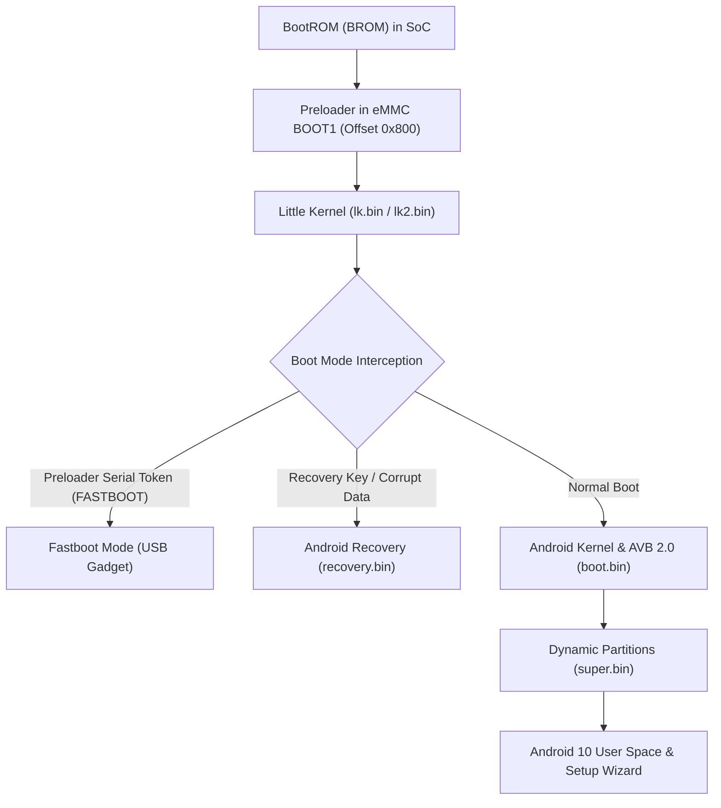

# Firmware Architecture: Xiaomi Smart Clock LX04 vs X04G

This technical document details the boot chain, security mechanisms, filesystem structures, and partition designs of the original Chinese firmware versus the target Global firmware.

---

## 1. Boot Chain Architecture

### Stage 1: BootROM (BROM)
- Hardcoded in MT8167 silicon mask ROM.
- Executes immediately on power applied.
- Checks BROM USB handshake pin/token.
- Reads eMMC `BOOT1` sector 0: parses `EMMC_BOOT` header.
- Validates the preloader hash against public keys fused in efuse.
- Loads preloader into internal SRAM (`0x00200000`) and executes.

### Stage 2: Preloader (`preloader_mico_x04g.bin`)
- Initializes basic clocks, PMIC power rails, and the External Memory Interface (EMI / LPDDR3).
- Listens on USB CDC serial for `b"FASTBOOT"` handshake token during initial 500ms window.
- Loads Little Kernel (`lk.bin`) from eMMC `USER` partition into DRAM (`0x41e00000`).
- Hands over execution to Little Kernel.

### Stage 3: Little Kernel (`lk.bin`)
- MediaTek's bootloader engine (LK v2.0 build `451d69f-20210619`).
- Initializes display driver IC (`jd9161z` / `gc9503w`) and renders splash screen.
- Checks boot argument (`BOOT_ARGUMENT_FASTBOOT`). If set, initializes USB Fastboot gadget.
- Validates AVB 2.0 signatures via `vbmeta.bin`.
- Loads Linux kernel (`boot.bin`) into DRAM and starts ARM Linux execution.

### Stage 4: Linux Kernel & Android Verified Boot (AVB 2.0)
- Linux 4.9.190-perf kernel.
- Mounts Android Dynamic Partitions from `super.bin` (`system`, `vendor`, `product`).
- Mounts `/data` with FBE (File-Based Encryption).

---

## 2. Chinese (LX04) vs. Global (X04G) Architectural Differences

| Subsystem | China Firmware (`mico_lx04`) | Global Firmware (`mico_x04g`) |
| :--- | :--- | :--- |
| **Android Version** | Android 8.1 Oreo (`alps-mp-o1.mp5_W18.34`) | Android 10 (`QP1A.190711.020 / 1.7.5`) |
| **Partition Scheme** | Traditional static partitions (`system`, `vendor`, `odmdtbo`) | Android Dynamic Partitions (`super` container) |
| **Security Framework** | MediaTek Legacy Certificate Chain (`cert2`, GFH headers) | Pure Android Verified Boot 2.0 (`vbmeta`, `vbmeta_system`, `vbmeta_vendor`) |
| **User Interface** | Custom Xiaomi XiaoAI display framework | Google Smart Display / Embedded Android 10 Global UI |
| **Cloud Services** | Xiaomi Mainland China IoT servers (`*.mi.com`) | Google Home / Global Xiaomi cloud servers |
| **System Language** | Simplified Chinese only | English, Spanish, French, German, Japanese, etc. |
| **Voice Assistant** | Xiaomi XiaoAI (Mandarin) | Google Assistant (Multilingual) |

---

## 3. Dynamic Partitions Super Structure

In Global Android 10, the static `system`, `vendor`, and `product` partitions are replaced by a single 1.50 GB raw block partition named **`super`** (1,610,612,736 bytes).

### Dynamic Header Geometry:
- **LBA Offset 8 (Byte Offset 4096):** Primary Superblock Header. Magic: `0x67446c61` (`gDla`).
- **LBA Offset 16 (Byte Offset 8192):** Secondary Superblock Header. Magic: `0x67446c61` (`gDla`).
- **Internal Logical Volumes:**
  - `system`: Android OS framework, applications, and runtime.
  - `vendor`: MediaTek MT8167 hardware abstraction layer (HAL) drivers and proprietary firmware blobs.
  - `product`: Device-specific assets, audio sounds, and fonts.

---

## 4. Android Verified Boot (AVB 2.0) Engine

The Global firmware enforces Google AVB 2.0 verification:
1. `vbmeta.bin`: Contains root cryptographic hashes, public keys, and rollback index descriptors.
2. `vbmeta_system.bin`: Chained descriptor for verifying `/system` filesystem tree.
3. `vbmeta_vendor.bin`: Chained descriptor for verifying `/vendor` filesystem tree.

When the bootloader is unlocked via `fastboot flashing unlock`, Little Kernel switches the boot state from `Green State` (locked/verified) to `Orange State` (unlocked). In Orange State, AVB warnings are displayed for 5 seconds, but kernel execution is permitted even if partition hashes differ from factory keys.
