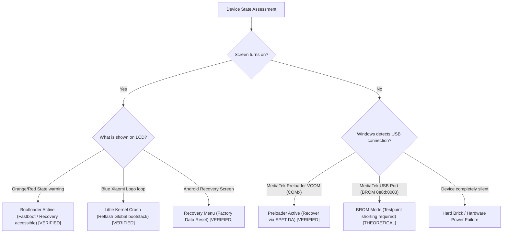

# Emergency Recovery & Unbrick Guide: Xiaomi Smart Clock LX04

This guide provides step-by-step procedures to recover your clock if flashing is interrupted, power is lost, or the device enters a non-booting state.

---

## 1. Classification of Device Failure States & Evidentiary Status

| Recovery Mode | Device Port / Interface | Hardware Access Mechanism | Verification Level | Practical Use Case |
| :--- | :--- | :--- | :--- | :--- |
| **1. Android Fastboot Mode** | `Android Bootloader Interface` (`18d1:d00d`) | Little Kernel (`lk.bin`) USB gadget | **[VERIFIED]** | Re-flash damaged `boot`, `dtbo`, `recovery`, `vbmeta` |
| **2. Android Recovery Mode** | LCD Menu / Volume navigation | Recovery kernel (`recovery.bin`) | **[VERIFIED]** | Execute `Factory data reset` to re-encrypt `/data` |
| **3. Preloader VCOM Mode** | `MediaTek Preloader USB VCOM` (`0e8d:2000`) | eMMC `BOOT1` Preloader USB CDC | **[VERIFIED]** | Intercept boot for Fastboot, or initiate SPFT flash |
| **4. DA High-Speed VCOM Mode**| `MediaTek DA USB VCOM` | DRAM Stage 2 Download Agent | **[VERIFIED]** | Contiguous streaming of `super.bin` and GPT tables |
| **5. BootROM (BROM) Mode** | `MediaTek USB Port` (`0e8d:0003`) | Silicon Mask ROM fallback | **[THEORETICAL / UNTESTED]** | Emergency unbrick if `BOOT1` is erased (requires testpoint) |



---

## 2. Recovery Scenario A: Device Boots to Android Recovery [VERIFIED]

### Symptoms:
The clock screen lights up with:
```text
xiaomi/mico_x04g/mico_x04g
10/QP1A.190711.020/1.7.5
user /release-keys
can't load android system your data may be corrupt
Choices:
  Try again
  Factory data reset
```

### Action:
1. Ensure you have flashed `super.bin` contiguously via SP Flash Tool (NOT Fastboot).
2. Press **Volume Down (-)** to highlight **Factory data reset**.
3. Press **Power / Mute** button to select.
4. Confirm by selecting **Yes**.
5. Once wipe finishes, select **Reboot system now**.
6. The clock will reboot past the Orange/Red state warning and enter the Global Setup Wizard.

---

## 3. Recovery Scenario B: Device Stuck in Fastboot Mode [VERIFIED]

### Symptoms:
The clock boots and remains in Fastboot mode (or `fastboot devices` reports `<serial_number>	fastboot`).

### Action:
Re-flash the complete core bootchain via Fastboot:
```powershell
fastboot flash boot firmware/boot.bin
fastboot flash dtbo firmware/dtbo.bin
fastboot flash vbmeta firmware/vbmeta.bin
fastboot flash vbmeta_system firmware/vbmeta_system.bin
fastboot flash vbmeta_vendor firmware/vbmeta_vendor.bin
fastboot flash recovery firmware/recovery.bin
fastboot flash cache firmware/cache.bin
fastboot flash metadata firmware/metadata.bin
fastboot flash md_udc firmware/md_udc.bin
fastboot flash para firmware/para.bin
fastboot erase userdata
fastboot reboot
```

---

## 4. Recovery Scenario C: Black Screen, Preloader / DA USB Enumeration [VERIFIED]

### Symptoms:
The screen is black, but Windows Device Manager momentarily shows `MediaTek Preloader USB VCOM (COMx)`.

### Action: Full Low-Level SP Flash Tool Restoration
1. Open **SP Flash Tool v5.1812**.
2. Select Download-Agent: `tools/DA_Mi_Hikaru-resign.bin`.
3. Select Scatter File: `configurations/scatter/convert_scatter_global.txt`.
4. Select Authentication File: `tools/auth_sv5.auth`.
5. Check:
   - `pgpt` -> `configurations/gpt/gpt_x04g_kingston.bin`
   - `sgpt` -> `configurations/gpt/gpt_backup_x04g_kingston.bin`
   - `lk` -> `firmware/lk.bin`
   - `super` -> `firmware/super.bin`
6. Click **Download**.
7. Connect the USB cable to the clock.
8. Wait for the green OK circle.

---

## 5. Recovery Scenario D: Hardware Testpoint BROM Recovery [THEORETICAL / UNTESTED]

### Symptoms:
The device is completely unresponsive, does not enumerate as Preloader VCOM, and `BOOT1` was corruptly overwritten.

### Mechanism:
MediaTek MT8167 SoCs feature a hardware KCOL0 / testpoint pad on the motherboard. Shorting this testpoint to ground (GND) while connecting USB forces the BROM to halt eMMC boot and expose `MediaTek USB Port (0e8d:0003)` directly over USB.
- *Status:* **Untested on this unit.** Because the physical Preloader on `BOOT1` remained functional throughout all phases of this project, physical device teardown and hardware testpoint shorting were never required.

---

## 6. Recovery Scenario E: Restoring Factory Chinese Firmware [INFERRED / PARTIALLY VERIFIED]

If you ever wish to revert completely to the factory Chinese firmware:
1. Locate your initial `LX04-Backup` directory created during Step 1 of the conversion.
2. In SP Flash Tool, load the Chinese scatter file `MT8167_Android_scatter.txt`.
3. Map the original backup files:
   - `boot` -> `LX04-Backup/boot_a.bin`
   - `lk` -> `LX04-Backup/lk_a.bin`
   - `system` -> `LX04-Backup/system_a.bin`
   - `vendor` -> `LX04-Backup/vendor_a.bin`
   - `pgpt` -> `LX04-Backup/gpt.bin`
4. Restore calibration backups if needed:
   - `nvram` -> `LX04-Backup/nvram.bin`
   - `proinfo` -> `LX04-Backup/proinfo.bin`
5. Flash via SP Flash Tool in `Download Only` mode.
